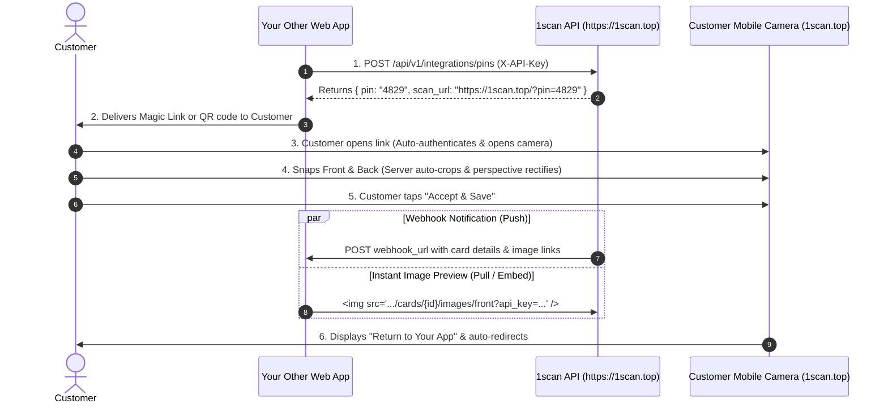

# 1scan (CardScanner) External Web App Integration Guide

Connect your external web applications (e-commerce platforms, customer portals, CRM/order management systems) with **1scan (`CardScanner`)** to programmatically generate customer access PINs, let customers snap gift cards with automated perspective rectification, and display instant card previews in your other web apps.

---

## Architecture Overview



---

## 1. Getting Your API Key

1. Log into your **1scan Operations Console** at `https://1scan.top/admin`.
2. Navigate to the **"API Keys & Integrations"** tab.
3. Click **"Generate New API Key"**, enter a descriptive name (e.g., *"Main Shopify Store"*), and click **"Generate Key"**.
4. Copy the generated secret key (starts with `sk_live_...`). Store it securely in your other app's environment variables (`.env`).

---

## 2. Authentication

Authenticate your requests using one of the following methods:

| Method | Syntax | Recommended Use Case |
| :--- | :--- | :--- |
| **HTTP Header** | `X-API-Key: sk_live_...` | Standard backend API calls |
| **Bearer Token** | `Authorization: Bearer sk_live_...` | Standard REST clients |
| **Query Parameter** | `?api_key=sk_live_...` | Embedding images directly in `` |

---

## 3. API Reference

### A. Generate Access PIN & Magic Link

Create a new PIN and an instant camera launch URL for your customer.

* **Method**: `POST`
* **URL**: `https://1scan.top/api/v1/integrations/pins`
* **Headers**: 
  * `X-API-Key: YOUR_API_KEY`
  * `Content-Type: application/json`

#### Request Body:
```json
{
  "label": "Order #98421",
  "card_type": "single",
  "max_scans": 1,
  "expires_in_hours": 24,
  "webhook_url": "https://yourotherapp.com/api/webhooks/card-scanned",
  "redirect_url": "https://yourotherapp.com/orders/98421/success"
}
```

| Parameter | Type | Required | Description |
| :--- | :--- | :--- | :--- |
| `label` | `string` | No | Your internal order ID, customer reference, or memo. |
| `card_type` | `string` | No | `"single"` (1-sided) or `"double"` (2-sided front & back). Default is `"single"`. |
| `pin_length` | `integer`| No | `4` or `5` digits (default: `4`). |
| `max_scans` | `integer`| No | Number of cards customer can scan with this PIN (default: `1`). |
| `expires_in_hours` | `integer`| No | Hours until PIN expires (default: `24`). |
| `webhook_url` | `string` | No | URL on your app to receive an instant POST callback when customer finishes. |
| `redirect_url`| `string` | No | Return URL to redirect customer back to your app after scanning. |

#### Response (`201 Created`):
```json
{
  "success": true,
  "pin": "4829",
  "pin_id": "c3a1b80d-85f2-4e89-9e8c-8f24eb0e6a12",
  "scan_url": "https://1scan.top/?pin=4829",
  "label": "Order #98421",
  "card_type": "single",
  "status": "active",
  "max_scans": 1,
  "completed_scans": 0,
  "expires_at": "2026-10-19T02:30:00",
  "webhook_url": "https://yourotherapp.com/api/webhooks/card-scanned",
  "redirect_url": "https://yourotherapp.com/orders/98421/success"
}
```

---

### B. Check PIN Status & Retrieve Scanned Cards

Poll the status of a PIN or retrieve the list of completed cards.

* **Method**: `GET`
* **URL**: `https://1scan.top/api/v1/integrations/pins/{pin_or_pin_id}`
* **Headers**: `X-API-Key: YOUR_API_KEY`

> You can pass either the 4-digit PIN string (`4829`) or the UUID `pin_id`.

#### Response (`200 OK`):
```json
{
  "pin_id": "c3a1b80d-85f2-4e89-9e8c-8f24eb0e6a12",
  "label": "Order #98421",
  "status": "completed",
  "completed_scans": 1,
  "max_scans": 1,
  "expires_at": "2026-10-19T02:30:00",
  "scan_url": "https://1scan.top/?pin=c3a1b80d-85f2-4e89-9e8c-8f24eb0e6a12",
  "cards": [
    {
      "id": "7df32a81-18e3-4f10-9280-5cae6f0bb992",
      "reference_code": "GC-4829-9Q2K",
      "card_type": "single",
      "status": "completed",
      "created_at": "2026-10-18T02:40:15",
      "images": [
        {
          "side": "front",
          "preview_url": "https://1scan.top/api/v1/integrations/cards/7df32a81-18e3-4f10-9280-5cae6f0bb992/images/front",
          "original_url": "https://1scan.top/api/v1/integrations/cards/7df32a81-18e3-4f10-9280-5cae6f0bb992/images/front?type=original",
          "width": 1280,
          "height": 807,
          "mime_type": "image/jpeg"
        }
      ]
    }
  ]
}
```

---

### C. Stream / Embed Image Previews Directly

Stream the perspective-corrected, cropped card image directly to an `` element in your other app's dashboard or frontend.

* **Method**: `GET`
* **URL**: `https://1scan.top/api/v1/integrations/cards/{card_id}/images/{side}?api_key=YOUR_API_KEY`
* **Query Parameters**:
  * `side`: `"front"` or `"back"`
  * `type`: `"processed"` (auto-cropped & rectified, default) or `"original"` (unaltered camera frame)
  * `api_key`: `YOUR_API_KEY`

#### Direct HTML / React Example:
```html

```

---

### D. Webhook Event (`card.scanned`)

When the customer confirms and saves their card on `1scan.top`, 1scan immediately issues an HTTP `POST` request to your `webhook_url`:

```json
{
  "event": "card.scanned",
  "pin": "Order #98421",
  "pin_label": "Order #98421",
  "card_id": "7df32a81-18e3-4f10-9280-5cae6f0bb992",
  "reference_code": "GC-4829-9Q2K",
  "card_type": "single",
  "images": {
    "front": {
      "preview_url": "https://1scan.top/api/v1/integrations/cards/7df32a81-18e3-4f10-9280-5cae6f0bb992/images/front",
      "original_url": "https://1scan.top/api/v1/integrations/cards/7df32a81-18e3-4f10-9280-5cae6f0bb992/images/front/original",
      "width": 1280,
      "height": 807,
      "file_size": 245120,
      "mime_type": "image/jpeg"
    }
  },
  "timestamp": "2026-10-18T02:40:15"
}
```

---

## 4. Code Examples

### Node.js / TypeScript (Express or Next.js)

```typescript
// 1. Generate PIN for an order
async function createCardScanPin(orderId: string) {
  const response = await fetch("https://1scan.top/api/v1/integrations/pins", {
    method: "POST",
    headers: {
      "X-API-Key": process.env.CARDSCAN_API_KEY!,
      "Content-Type": "application/json",
    },
    body: JSON.stringify({
      label: `Order #${orderId}`,
      card_type: "double", // 2-sided card
      max_scans: 1,
      expires_in_hours: 24,
      webhook_url: "https://myotherapp.com/api/webhooks/card-scanned",
      redirect_url: `https://myotherapp.com/orders/${orderId}/complete`,
    }),
  });

  const data = await response.json();
  // Send data.scan_url to the customer (e.g. via email, SMS, or direct redirect)
  return data.scan_url; // "https://1scan.top/?pin=4829"
}

// 2. Webhook receiver
import express from "express";
const app = express();
app.use(express.json());

app.post("/api/webhooks/card-scanned", (req, res) => {
  const { reference_code, card_id, images } = req.body;
  console.log(`Card ${reference_code} scanned! Preview: ${images.front?.preview_url}`);
  
  // Store reference_code and card_id in your database for order fulfillment
  res.status(200).send({ received: true });
});
```

---

### Python (FastAPI / Flask / Django)

```python
import os
import requests

API_KEY = os.environ.get("CARDSCAN_API_KEY")

def generate_customer_scan_link(order_id: str) -> str:
    response = requests.post(
        "https://1scan.top/api/v1/integrations/pins",
        headers={"X-API-Key": API_KEY},
        json={
            "label": f"Order #{order_id}",
            "card_type": "single",
            "max_scans": 1,
            "webhook_url": "https://myotherapp.com/api/webhooks/card-scanned",
            "redirect_url": f"https://myotherapp.com/orders/{order_id}/thank-you",
        },
    )
    response.raise_for_status()
    data = response.json()
    return data["scan_url"]  # https://1scan.top/?pin=4829


def get_card_status(pin_or_id: str):
    response = requests.get(
        f"https://1scan.top/api/v1/integrations/pins/{pin_or_id}",
        headers={"X-API-Key": API_KEY},
    )
    return response.json()
```

---

## 5. Security & Best Practices

1. **Keep Your API Key Confidential**: Never expose your `sk_live_...` API key in public client-side browser code (except when generating authorized image `src` preview URLs protected behind your staff/admin session).
2. **Key Rotation & Revocation**: If an API key is compromised, you can revoke it instantly from the **API Keys** tab in `1scan.top/admin`.
3. **Webhook Verification**: Ensure your webhook handler acknowledges requests promptly with an HTTP `200` status.
